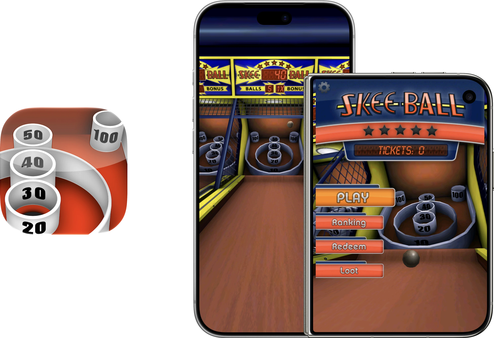

  

# Respring – Skee-Ball
The original Skee-Ball game, restored with the help of Codex (GPT-6 Astra and GPT 6.1 Sol) for modern iPhones as part of project Respring!

### How does it work?
This build runs the original Unity game using ARM/Thumb CPU emulation and a modified touchHLE compatibility runtime. A native iOS host handles the window, graphics presentation, input, and audio. No JIT is required!

### Enhancements
- Full Resolution: the 3D portion of the game will fill the display, while keeping the UI centered in its original 3.5-inch iPhone layout.
- Live Resizing: rendering and touch mapping adapt to rotation window size changes. Great for iPhone Duo!
- App Icon: I have "remastered" the app icon with Icon Composer with full support for Default, Dark, Clear, and Tinted modes.

### Notes
- The app enhancements can be enabled or disabled in Settings → Apps → Skee Free.
- The game UI must remain in the 3.5-inch aspect ratio, as it was never designed to be responsive/adaptive to other sizes.
- Discontinued online services and Plus+ accounts are unavailable and have been removed.
- It's not perfect! There may still be crashes. If you experience a crash or some other issue, please open an Issue on this repository.

As stated before, this project was achieved through the usage of generative AI. Outside of this README and Releases release notes, most things were written by an AI agent.

## How to Install
Download **Skee-Ball.ipa** from [Releases](https://github.com/DylanMcD8/respring-skee-ball/releases). It is an **unsigned ARM64 device IPA**: use your own signing/sideloading workflow to sign it for your device. [Sideloadly](https://sideloadly.io) is one option.

Alternatively, build and run **SkeeBall.xcodeproj** with your own Apple development team.

The deployment target is iOS/iPadOS 15.0. Earlier testing covered iPhone 18 Pro and the iPhone Duo simulator with rotation, fold/unfold, and touch checks. The current host also permits iPad installation. These tests do not establish compatibility with every older OS version. The simulator build targets Apple silicon Macs.

## Build from Source
*Written by AI agent*

Use an Apple silicon Mac with full Xcode, Python 3, Rust 1.99.0, and CMake. Xcode 27.1 and CMake 4.3.5 were used for the completed restoration builds. Rust dependencies and the modified SDL2 sources are included.

1. Install the toolchain and ARM64 targets described in [BUILDING.md](BUILDING.md).
2. Open `SkeeBall.xcodeproj`, select the **SkeeBall** scheme and your destination.
3. For a physical device, select your own development team and an available bundle identifier.
4. Build and run. The first build compiles the runtime and can take a while.

See [BUILDING.md](BUILDING.md) for command-line builds, packaging, tests, and source layout.

## Credits and Licensing
Skee-Ball and its original game content belong to their respective rights holders. The original executable, artwork, audio, and game-derived material are not relicensed by this project's open-source notices. This is an unofficial preservation project with no claim of rights-holder affiliation or endorsement.

The compatibility runtime derives from [touchHLE](https://github.com/touchHLE/touchHLE), with MPL-2.0 notices preserved. SDL2, Rust dependencies, fonts, and bundled runtime libraries retain their own licenses.

See [LICENSE.md](LICENSE.md), [THIRD_PARTY_NOTICES.md](THIRD_PARTY_NOTICES.md), and the notices beside the sources. Matching project and runtime source downloads accompany the IPA.
